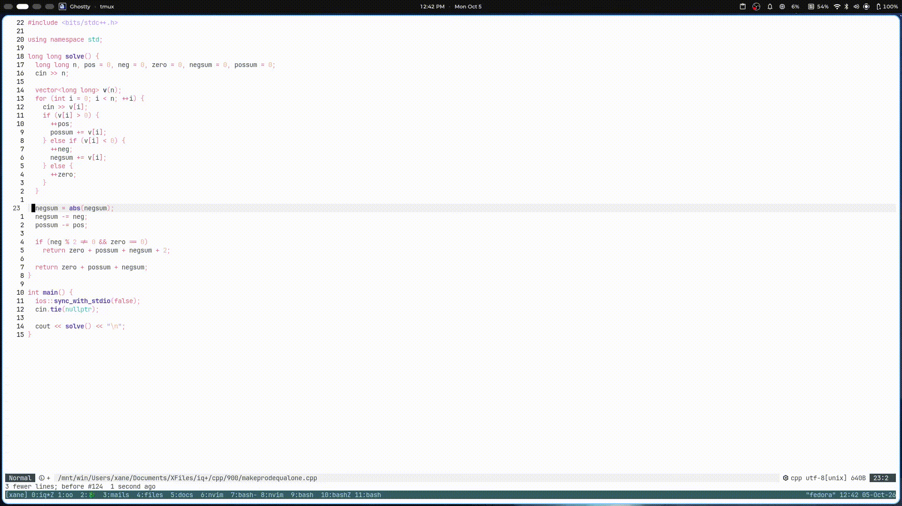

# cxp.nvim

A tiny Neovim plugin for competitive programming. Open a side panel with an **Input** and an **Output** buffer, hit one key, and your current file is compiled (if needed), fed the Input buffer on stdin, and the result shows up in the Output buffer, along with stderr, exit code and run time.

No config, no dependencies, ~200 lines of Lua.



## Features

- Split panel on the right: **Input** (top) and **Output** (bottom)
- One key to compile and run the current file with the Input buffer as stdin
- Shows stdout, a separator, then stderr, followed by `exit <code> | <ms> ms`
- Human-readable messages for common crashes (SIGSEGV, SIGFPE, SIGABRT, SIGKILL)
- Compiler errors are shown directly in the Output buffer
- Re-running kills any job that is still running
- Fully async, so Neovim never blocks

## Requirements

- Neovim **0.12+** (for `vim.pack`)
- Depending on the languages you use:

| Language   | Needs                                                |
|------------|------------------------------------------------------|
| C++        | `clang++` (compiled with `-std=c++23 -O2 -Wall`)     |

## Installation

Using Neovim's built-in package manager, `vim.pack`:

```lua
vim.pack.add({ 'https://github.com/hardikxk/cxp.nvim' })

require('cxp').setup()
```

To pin a release, use a spec table:

```lua
vim.pack.add({
  { src = 'https://github.com/hardikxk/cxp.nvim', version = 'v0.1.0' },
})
```

Update plugins with `:lua vim.pack.update()`.

## Usage

| Key          | Action                                   |
|--------------|------------------------------------------|
| `<leader>c`  | Toggle the Input/Output panel            |
| `<leader>r`  | Save, compile (if needed) and run        |

1. Open a source file (`solution.cpp`, `main.py`, ...).
2. Press `<leader>c` to open the panel.
3. Paste your test input into the **Input** buffer.
4. Press `<leader>r` from the code window.
5. Read the result in the **Output** buffer.

Output looks like this:

```
42
--------------------------

exit 0  |  12 ms
```

Anything printed to stderr appears below the separator line.

### Custom keymaps

`setup()` only creates the two default keymaps. If you want different keys, skip `setup()` and map the functions yourself:

```lua
local cp = require('cxp')

vim.keymap.set('n', '<F5>', cp.run,    { desc = 'CP: compile & run' })
vim.keymap.set('n', '<F6>', cp.toggle, { desc = 'CP: toggle panel' })
```

### API

| Function                   | Description                                |
|----------------------------|--------------------------------------------|
| `require('cxp').setup()`   | Registers the default keymaps              |
| `require('cxp').toggle()`  | Opens or closes the Input/Output panel     |
| `require('cxp').run()`     | Saves, compiles (if needed) and runs       |

## How it works

- C++ files are compiled to `/tmp/cp_<filename>` with `clang++`, then the binary is executed.
- TypeScript, JavaScript and Python files are run directly with their interpreter.
- The Input buffer is piped to the process via stdin, and stdout/stderr are collected and shown once the process exits.

## Limitations

- Compiler flags and the C++ standard are currently hardcoded (`-O2 -Wall -std=c++23`).
- The binary path assumes a Unix-like system (`/tmp`).
- Output is shown when the program exits (not streamed live), and programs that wait for interactive input will hang until stopped by re-running.

## Contributing

Issues and pull requests are welcome. If you want to add a language, the place to look is `M.run()` in `lua/cxp/init.lua`.

## License

[GPL-3.0](./LICENSE)
